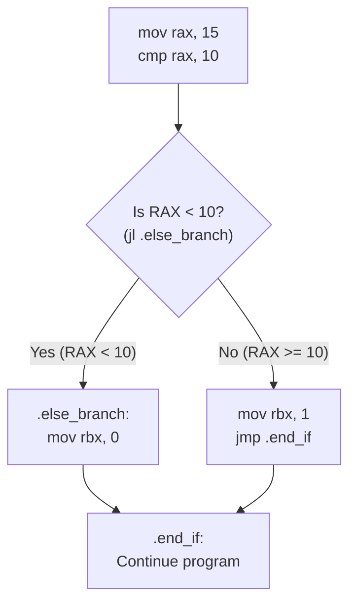
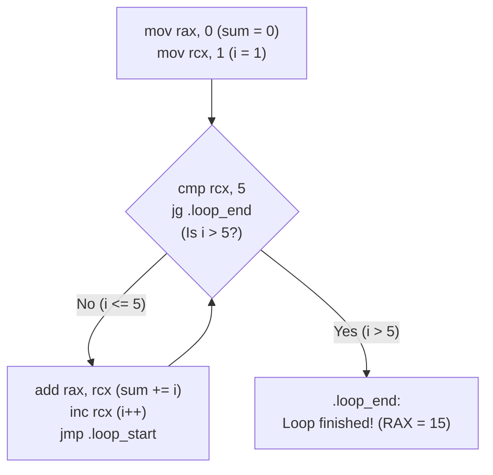

# The Complete Visual Guide to Assembly Language (Beginner-Friendly with Diagrams)

Welcome! If you are completely new to Assembly Language, this guide uses **visual diagrams** at every step so you can **see** what is happening inside the CPU and RAM when each line of code runs.

---

## 1. What is Assembly Language? (Visual Overview)

Computers only understand **Machine Code** (raw binary `0`s and `1`s). Because humans cannot easily read `01001000 11000111 11000000 00000101`, we use **Assembly Language**—where every binary instruction has a short nickname called a **mnemonic** (like `MOV`, `ADD`, `SUB`).

### Diagram 1: From High-Level Code to the CPU
```text
+-------------------------------------------------------------------+
| 1. HIGH-LEVEL CODE (JavaScript / C / Solidity)                    |
|    let total = 5 + 3;                                             |
+-------------------------------------------------------------------+
                                 |
                                 v  (Compiler translates to Assembly)
+-------------------------------------------------------------------+
| 2. ASSEMBLY LANGUAGE (.asm)  <-- YOU ARE LEARNING THIS!           |
|    MOV RAX, 5       ; Put 5 into register RAX                     |
|    ADD RAX, 3       ; Add 3 to register RAX                       |
+-------------------------------------------------------------------+
                                 |
                                 v  (Assembler translates 1-to-1)
+-------------------------------------------------------------------+
| 3. MACHINE CODE (Binary / Hexadecimal)                            |
|    48 C7 C0 05 00 00 00   (1001000 11000111 ...)                  |
|    48 83 C0 03                                                    |
+-------------------------------------------------------------------+
                                 |
                                 v  (Executed by Hardware)
+-------------------------------------------------------------------+
| 4. CPU HARDWARE (Transistors & Logic Gates)                       |
+-------------------------------------------------------------------+
```

---

## 2. How the CPU & RAM Work Together

Before writing Assembly, picture the computer as **two buildings**:
1. **RAM (Memory):** A giant warehouse with millions of numbered lockers (addresses `0x0000`, `0x0001`, `0x0002`...), **but it cannot do math** and is relatively slow.
2. **The CPU (Processor):** A tiny workshop with a calculator (**ALU - Arithmetic Logic Unit**) and a handful of workbench slots called **Registers**.

### Diagram 2: Inside the CPU vs. RAM (The Fetch-Decode-Execute Cycle)
```text
+-----------------------------------------------+         +-----------------------------+
|                     CPU                       |         |        RAM (Memory)         |
|                                               |         |                             |
|  +-----------------------------------------+  |         |  Address   | Data / Code    |
|  | CONTROL UNIT                            |  |  Fetch  |------------+----------------|
|  |  RIP (Instruction Pointer) = 0x1000 ----+--+-------->|  0x1000    | MOV RAX, 5     |
|  +-----------------------------------------+  |         |  0x1007    | ADD RAX, 3     |
|                       |                       |         |  0x100B    | MOV [0x2000],RAX|
|                       v                       |         |  ...       | ...            |
|  +-----------------------------------------+  |  Read/  |  0x2000    | 00000008       |
|  | REGISTERS (Ultra-Fast Workbenches)      |  |  Write  |  0x2008    | 00000000       |
|  |  RAX: [       8       ]                 |<==========>|  0x2010    | 00000000       |
|  |  RBX: [       0       ]                 |  |         +-----------------------------+
|  |  RCX: [       0       ]                 |  |
|  |  RSP: [    0x7FFF     ] (Stack Pointer) |  |
|  +-----------------------------------------+  |
|                       |                       |
|                       v                       |
|  +-----------------------------------------+  |
|  | ALU (Calculator: +, -, *, AND, OR, CMP) |  |
|  |  Updates Status Flags: [ZF=0 | SF=0]    |  |
|  +-----------------------------------------+  |
+-----------------------------------------------+
```
**How the CPU runs your program (3 steps repeated billions of times per second):**
1. **FETCH:** Look at `RIP` (Instruction Pointer) to see which address in RAM holds the next instruction, and load it into the CPU.
2. **DECODE:** Figure out what the instruction means (e.g., "`ADD RAX, 3` means add 3 to `RAX`").
3. **EXECUTE:** Perform the operation in the **ALU / Registers**, and advance `RIP` to the next instruction.

---

## 3. Inside CPU Registers (Visualizing Register Slices)

In a 64-bit x86-64 CPU, each general-purpose register (`RAX`, `RBX`, `RCX`, `RDX`, etc.) is **64 bits (8 bytes) wide**.
However, you can also access just the lower 32 bits, 16 bits, or 8 bits of the **exact same register**!

### Diagram 3: Anatomy of the `RAX` Register (64-bit down to 8-bit)
```text
|<----------------------------------- RAX (64 bits / 8 bytes) ----------------------------------->|
+------------------------------------------------+------------------------------------------------+
|                  Upper 32 bits                 |            EAX (Lower 32 bits / 4 bytes)       |
+------------------------------------------------+-----------------------+------------------------+
                                                 |     Upper 16 bits     |   AX (16 bits / 2B)    |
                                                 +-----------------------+-----------+------------+
                                                                         | AH (8bit) | AL (8bit)  |
                                                                         +-----------+------------+
                                                                          bits 15..8   bits 7..0
```
- Put a 64-bit number in `RAX` -> uses the **whole box**.
- Put a single ASCII character (`'A'`) in `AL` -> uses only the **bottom-right 8-bit box**!

### Quick Reference Table of Registers
```text
+----------+-------------------------------------------------------------------+
| Register | Job / Nickname (Easy Way to Remember)                             |
+----------+-------------------------------------------------------------------+
|   RAX    | Accumulator: Used for math results and function RETURN values     |
|   RBX    | Base: General storage box / memory pointer                        |
|   RCX    | Counter: Counts loops (i = 0, 1, 2...)                            |
|   RDX    | Data: Helps RAX during multiplication/division & I/O              |
|   RDI    | Destination Index: 1st argument passed into a function            |
|   RSI    | Source Index:      2nd argument passed into a function            |
|   RSP    | Stack Pointer:     Always points to the TOP of the Stack          |
|   RBP    | Base Pointer:      Marks the base of the current function's stack |
|   RIP    | Instruction Ptr:   Points to the NEXT line of code to run         |
+----------+-------------------------------------------------------------------+
```

---

## 4. Program Memory Layout (How RAM is Organized)

When your Assembly program runs, the Operating System gives it a layout in RAM divided into **4 main zones**:

### Diagram 4: RAM Layout of a Running Program
```text
HIGH MEMORY ADDRESS (e.g., 0x7FFFFFFFFFFF)
+---------------------------------------------------+
|                    THE STACK                      |
|  Stores local variables & function return addrs.  |
|  RSP points here ---> [ Local Var 2 ]             |
|                       |      |                    |
|                       v      v  (Grows DOWNWARD)  |
|                                                   |
| - - - - - - - - - (Free Space) - - - - - - - - - -|
|                                                   |
|                       ^      ^  (Grows UPWARD)    |
|                       |      |                    |
|                    THE HEAP                       |
|  Dynamic memory allocated at runtime              |
+---------------------------------------------------+
|  section .bss   (Uninitialized global variables)  |
|  e.g., empty buffers reserved for user input      |
+---------------------------------------------------+
|  section .data  (Initialized global variables)    |
|  e.g., msg db "Hello", 0                          |
+---------------------------------------------------+
|  section .text  (Your Assembly Code Instructions) |
|  e.g., MOV, ADD, JMP (Read-Only)                  |
+---------------------------------------------------+
LOW MEMORY ADDRESS (e.g., 0x000000400000)
```

---

## 5. Visualizing Core Instructions (`MOV`, `ADD`, `SUB`, `[]`)

In Intel Assembly syntax, think of every two-operand instruction as an arrow pointing **FROM the right (source) TO the left (destination)**:

```text
   INSTRUCTION   Destination  <---  Source
   MOV           RAX,               42        ; Put 42 into RAX
```

### Diagram 5: Step-by-Step Execution of `MOV`, `ADD`, `SUB`
```text
Step 1:  MOV RAX, 10          Step 2:  MOV RBX, 4           Step 3:  ADD RAX, RBX
(Put 10 into RAX)             (Put 4 into RBX)              (RAX = RAX + RBX)

+-------+    +-------+        +-------+    +-------+        +-------+    +-------+
|  RAX  |    |  RBX  |        |  RAX  |    |  RBX  |        |  RAX  |    |  RBX  |
|  10   |    |   0   |        |  10   |    |   4   |        |  14   |<---|   4   |
+-------+    +-------+        +-------+    +-------+        +-------+    +-------+
```

### Diagram 6: Register vs. Memory Dereferencing `[...]`
Square brackets `[...]` mean **"open the locker at this RAM address"**:
```text
Assume Register RBX holds the number 0x2000, and RAM Locker 0x2000 holds 99:

   Register RBX                   RAM Locker 0x2000
+----------------+              +-------------------+
|     0x2000     | -----------> |        99         |
+----------------+              +-------------------+

1) MOV RAX, RBX      -->  Copies the ADDRESS itself:      RAX becomes 0x2000
2) MOV RAX, [RBX]    -->  Opens locker 0x2000 in RAM:     RAX becomes 99
3) MOV [RBX], 50     -->  Puts 50 inside locker 0x2000:   RAM[0x2000] becomes 50
```

### Diagram 7: Array Indexing in Memory `[RBX + RCX * 8]`
Suppose an array of 64-bit numbers (each 8 bytes wide) starts at address `RBX = 0x3000`, and `RCX` is the array index (`0, 1, 2...`):
```text
RAM Address:    0x3000          0x3008          0x3010          0x3018
             +---------------+---------------+---------------+---------------+
Array Values:|     100       |     200       |     300       |     400       |
             +---------------+---------------+---------------+---------------+
                   ^               ^               ^               ^
             [RBX + 0*8]     [RBX + 1*8]     [RBX + 2*8]     [RBX + 3*8]
              (Index 0)       (Index 1)       (Index 2)       (Index 3)
```

---

## 6. Visualizing Decisions (`CMP` + Conditional Jumps)

Assembly does not have `if (rax == 10)` or `while (rcx < 5)`.
Instead, it works in **two steps**:
1. **`CMP A, B`**: Internally computes `A - B` and sets status lights (**Flags**) inside the CPU:
   - If `A == B`, `A - B = 0`, so the **Zero Flag (`ZF`)** turns ON (`1`).
   - If `A < B`, `A - B` is negative, so the **Sign Flag (`SF`)** turns ON (`1`).
2. **Jump (`JE`, `JNE`, `JG`, `JL`)**: Checks those status lights and teleports `RIP` to a label!

### Diagram 8: How `if / else` Works in Assembly


```nasm
    mov rax, 15
    cmp rax, 10         ; 1. Compare RAX with 10
    jl .else_branch     ; 2. If RAX < 10, jump to .else_branch

    ; --- IF BLOCK (runs when RAX >= 10) ---
    mov rbx, 1
    jmp .end_if         ; Jump over the else block!

.else_branch:
    ; --- ELSE BLOCK (runs when RAX < 10) ---
    mov rbx, 0

.end_if:
    ; Both paths meet here
```

### Diagram 9: How a `for` Loop Works in Assembly


---

## 7. Visualizing the Stack (`PUSH`, `POP`, `CALL`, `RET`)

Think of the **Stack** like a stack of plates that hangs **upside-down from the ceiling of RAM** (it grows **downward** toward lower addresses).
`RSP` (**Stack Pointer**) always points to the most recently added item at the bottom of the hanging stack.

### Diagram 10: How `PUSH` and `POP` Change the Stack
```text
INITIAL STATE                 AFTER: PUSH 10                AFTER: PUSH 20                AFTER: POP RBX
(RSP = 0x1010)                (RSP moves down by 8)         (RSP moves down by 8)         (RBX gets 20, RSP moves up)

Addr     Value                Addr     Value                Addr     Value                Addr     Value
0x1010 [  ---  ] <-- RSP      0x1010 [  ---  ]              0x1010 [  ---  ]              0x1010 [  ---  ]
0x1008 [       ]              0x1008 [  10   ] <-- RSP      0x1008 [  10   ]              0x1008 [  10   ] <-- RSP
0x1000 [       ]              0x1000 [       ]              0x1000 [  20   ] <-- RSP      0x1000 [ (20)  ] (popped->RBX)
```

### Diagram 11: What Happens During a Function `CALL` and `RET`
```text
Caller Code (_start)                                   Function (add_nums)
--------------------                                   -------------------
0x4000: mov rdi, 5
0x4007: mov rsi, 3
0x400E: call add_nums  ---(1. Pushes 0x4013 to Stack)-->  add_nums:
0x4013: mov rbx, rax   <--(2. RET pops 0x4013 to RIP)---    mov rax, rdi
                                                            add rax, rsi
                                                            ret
```
1. **`CALL add_nums`** saves the return bookmark (`0x4013`, the instruction right after `CALL`) onto the Stack, and jumps to `add_nums`.
2. **`RET`** pops that bookmark (`0x4013`) off the Stack back into `RIP`, so the CPU resumes right where it left off!

---

## 8. Visualizing EVM Assembly (Smart Contract Assembly)

When you write a Smart Contract in Solidity, it runs on the **Ethereum Virtual Machine (EVM)**.
Unlike an Intel CPU (which uses registers `RAX`, `RBX`), the **EVM has NO registers**—it does all math directly on a **256-bit Stack**!

### Diagram 12: How EVM Assembly Executes `add(5, 3)`
```text
EVM Instruction:         1. PUSH1 0x03          2. PUSH1 0x05          3. ADD
                         (Push 3 onto stack)    (Push 5 onto stack)    (Pop 5 & 3, push 5+3=8)

EVM Stack:               +---------------+      +---------------+      +---------------+
                         |       3       |      |       5       |      |       8       |
                         +---------------+      +---------------+      +---------------+
                                                |       3       |
                                                +---------------+
```

### Diagram 13: The 3 Data Areas of the EVM
```text
+---------------------------------------------------------------------------------+
|                         ETHEREUM VIRTUAL MACHINE (EVM)                          |
|                                                                                 |
|  1. STACK (Volatile, Free/Cheap)       2. MEMORY (Volatile RAM, Cleared on End) |
|  +-----------------------------+       +-------------------------------------+  |
|  | Top -> [ 256-bit word ]     |       | 0x00: [ 32 bytes ] (mload / mstore) |  |
|  |        [ 256-bit word ]     |       | 0x20: [ 32 bytes ]                  |  |
|  |        (Max 1024 items)     |       | 0x40: [ Free Memory Pointer ]       |  |
|  +-----------------------------+       +-------------------------------------+  |
|                                                                                 |
|  3. STORAGE (Permanent Blockchain Disk - Saved Across All Nodes!)               |
|  +---------------------------------------------------------------------------+  |
|  | Slot 0: [ owner address ]           <-- Read with sload(0), Write sstore  |  |
|  | Slot 1: [ totalBankBalance ]        <-- Read with sload(1), Write sstore  |  |
|  +---------------------------------------------------------------------------+  |
+---------------------------------------------------------------------------------+
```

### Example: Inline EVM Assembly Inside Solidity
```solidity
function addAndReadStorage(uint256 bonus) public view returns (uint256 total) {
    assembly {
        // 1. Read permanent storage slot 1 (totalBankBalance) onto the EVM stack
        let balanceInStorage := sload(1)

        // 2. Add 'bonus' to 'balanceInStorage' using the EVM ADD opcode
        total := add(balanceInStorage, bonus)
    }
}
```

---

## 9. Cheat Sheet: Every Essential Assembly Instruction in One Place

| Category | Instruction | Example | Plain-English Meaning |
| :--- | :--- | :--- | :--- |
| **Move Data** | `MOV` | `mov rax, 5` | Copy `5` into `rax` |
| **Load Address** | `LEA` | `lea rax, [rbx+8]` | Calculate `rbx + 8` and store the address in `rax` |
| **Math** | `ADD` / `SUB` | `add rax, rbx` | `rax = rax + rbx` / `rax = rax - rbx` |
| **Math (+1 / -1)** | `INC` / `DEC` | `inc rcx` | `rcx = rcx + 1` / `rcx = rcx - 1` |
| **Multiply** | `IMUL` | `imul rax, rbx` | `rax = rax * rbx` |
| **Bitwise** | `AND`, `OR`, `XOR` | `xor rax, rax` | Bitwise logic (`xor` a register with itself = `0`) |
| **Compare** | `CMP` | `cmp rax, 10` | Compare `rax` with `10` and update flags |
| **Jumps** | `JMP`, `JE`, `JNE`, `JG`, `JL` | `je .done` | Jump Always / Equal / Not Equal / Greater / Less |
| **Stack** | `PUSH` / `POP` | `push rax` | Push onto top of stack / Pop off top of stack |
| **Functions** | `CALL` / `RET` | `call my_func` | Call function (saves return address) / Return |
| **OS Call** | `SYSCALL` | `syscall` | Ask the OS kernel to perform I/O or exit |
