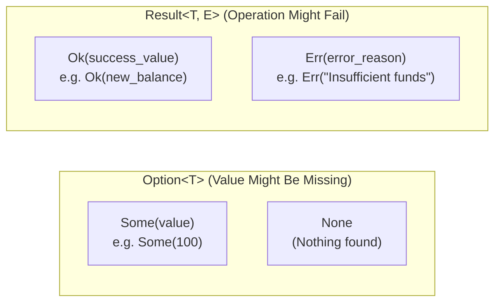

# The Complete Visual Guide to Rust (Beginner-Friendly with Diagrams)

Welcome to **Rust**! Rust is one of the most important programming languages in **Blockchain and Web3** (powering **Solana**, **Polkadot**, **NEAR**, **CosmWasm**, and high-performance Ethereum clients like **Reth**).

This guide uses **visual diagrams** and step-by-step examples so you can master Rust from scratch—especially its most famous feature: **Ownership & Borrowing**.

---

## 1. Why Rust? (And Why Blockchains Love It)

Most programming languages force you to choose between **Speed/Control** and **Safety**:

```text
+----------------------------------+----------------------------------+
| C / C++ / Assembly               | JavaScript / Python / Java       |
| - Extremely fast                 | - Safe & easy to write           |
| - Manual memory management       | - Uses a Garbage Collector (GC)  |
| - Risk of crashes & memory bugs! | - Slower & unpredictable pauses  |
+----------------------------------+----------------------------------+
                                   |
                                   v
            +----------------------------------------------+
            |                 RUST (.rs)                   |
            | - Fast as C/C++ (compiles to machine code)   |
            | - Memory-safe WITHOUT a Garbage Collector!   |
            | - Catches bugs at COMPILE TIME before it runs|
            +----------------------------------------------+
```
In a blockchain or smart contract, a single memory bug or race condition can cost millions of dollars, and a Garbage Collector is too slow for thousands of transactions per second. **Rust solves both.**

---

## 2. Variables & Mutability (`let` vs `let mut`)

In Rust, **variables are immutable (read-only) by default** for safety. To allow a variable to change, you add the keyword `mut` (mutable).

### Diagram 1: Immutable (`let`) vs. Mutable (`let mut`)
```text
1. IMMUTABLE (Locked Box):  let x = 5;
   +-----------+
   |   x = 5   |  🔒 Locked! Writing `x = 6;` causes a Compiler Error.
   +-----------+

2. MUTABLE (Unlocked Box):  let mut y = 5;
   +-----------+
   |   y = 5   |  🔓 Unlocked! Writing `y = 6;` changes the value to 6.
   +-----------+
```

### Code Example: Variables & Basic Data Types
```rust
fn main() {
    // 1. Immutable variable (cannot be changed later)
    let max_supply: u64 = 21_000_000;

    // 2. Mutable variable (can be changed because of `mut`)
    let mut balance: u64 = 100;
    balance = balance + 50; // Now balance is 150

    // 3. Primitive Data Types:
    let age: u32 = 25;             // Unsigned integer (only positive: u8, u16, u32, u64, u128)
    let temp: i32 = -10;           // Signed integer (positive or negative: i8, i16, i32, i64, i128)
    let price: f64 = 19.99;        // Floating-point decimal (f32, f64)
    let is_mined: bool = true;     // Boolean (true or false)
    let symbol: char = '₿';        // Single Unicode character (single quotes)

    // Print values using the println! macro (`{}` is a placeholder)
    println!("Max Supply: {}, Balance: {}, Symbol: {}", max_supply, balance, symbol);
}
```

---

## 3. Functions & Control Flow (`fn`, `if/else`, Loops)

### Diagram 2: Anatomy of a Rust Function
```text
   Keyword   Function Name   Parameter1   Parameter2    Return Type
     |            |              |            |              |
     v            v              v            v              v
    fn       add_tokens(        a: u64,      b: u64    ) -> u64 {
        a + b   // <-- Notice NO semicolon! In Rust, the last expression
                //     without a semicolon is automatically RETURNED!
    }
```
> **Important Rust Rule:**
> - `a + b` (no semicolon) is an **expression** that returns a value.
> - `a + b;` (with a semicolon) is a **statement** that throws the value away (or use `return a + b;`).

### Control Flow Examples (`if/else`, `loop`, `while`, `for`)
```rust
fn check_reward(blocks_mined: u32) -> &'static str {
    // In Rust, `if / else` can return a value directly!
    let status = if blocks_mined >= 10 {
        "Validator Tier"
    } else if blocks_mined >= 1 {
        "Miner Tier"
    } else {
        "New Node"
    };

    status // Returned automatically (no semicolon)
}

fn count_blocks() {
    // 1. `for` loop over a range (1..=5 means 1, 2, 3, 4, 5 inclusive)
    for block_num in 1..=5 {
        println!("Mining block #{}", block_num);
    }

    // 2. `while` loop
    let mut nonce = 0;
    while nonce < 3 {
        nonce += 1;
    }
}
```

---

## 4. Ownership & Borrowing (The Heart of Rust — Visualized!)

This is the **#1 concept** that makes Rust unique. Once you see the diagrams below, you will understand Rust forever.

### The 3 Golden Rules of Ownership
1. Every value in Rust has a variable that is its **Owner**.
2. There can only be **ONE Owner at a time**.
3. When the Owner goes out of scope (at the closing `}`), the value is **automatically dropped (freed from memory)**.

### Diagram 3: Stack Copy (`u64`) vs. Heap Move (`String`)
Simple fixed-size numbers (`u64`, `i32`, `bool`) live on the **Stack** and are cheap to copy.
Growable data like `String` or `Vec` lives on the **Heap**. When you assign a `String` to a new variable, Rust **MOVES** ownership instead of copying!

```text
CASE A: Simple Integer (Copied on the Stack)
    let a = 10;
    let b = a;   // Both `a` and `b` are valid!

    Stack:
    +---------+
    | a = 10  |  (Still valid)
    | b = 10  |  (Copy of 10)
    +---------+

CASE B: Heap Data (`String` - Ownership MOVES!)
    let s1 = String::from("Veroin");
    let s2 = s1;  // Ownership MOVES from s1 to s2! `s1` is now INVALID.

    Stack (Pointers)               Heap (Actual Text Data)
    +----------------+             +---+---+---+---+---+---+
    | s1 (INVALID!)  | - x - - -   | V | e | r | o | i | n |
    | s2 (NEW OWNER) | ----------->+---+---+---+---+---+---+
    +----------------+
```
Why does Rust invalidate `s1`? Because if both `s1` and `s2` tried to free the same Heap memory at the end of the function, it would cause a **Double-Free crash**!
*(Tip: If you actually want a full duplicate copy on the Heap, call `let s2 = s1.clone();`).*

---

### Borrowing with References (`&` and `&mut`)
What if you want a function to **read** or **update** a variable *without* taking ownership away?
You **Borrow** it using `&` (just like lending a book to a friend—they read it and give it back to you!).

### Diagram 4: Immutable Borrow (`&`) vs. Mutable Borrow (`&mut`)
```text
1. IMMUTABLE BORROW (`&T` - Read-Only View):
   You can have MANY immutable readers at the same time!

   ref1 (&s) -----\     +------------------+
   ref2 (&s) ------>--->| Owner `s`        |
   ref3 (&s) -----/     | "Hello, Rust"    |
   (All can READ)       +------------------+

2. MUTABLE BORROW (`&mut T` - Read & Write Access):
   You can only have ONE mutable borrower at a time (prevents data races!).

                        +------------------+
   mut_ref (&mut s) --->| Owner `s`        |  (No other readers or writers
   (EXCLUSIVE ACCESS)   | "Hello, Rust!"   |   allowed while mut_ref is active)
                        +------------------+
```

### Code Example: Ownership vs. Borrowing
```rust
// 1. Borrows `name` as READ-ONLY (`&String`) -> caller keeps ownership!
fn print_wallet(name: &String) {
    println!("Wallet Owner: {}", name);
}

// 2. Borrows `balance` as MUTABLE (`&mut u64`) -> can modify caller's variable!
fn add_mining_reward(balance: &mut u64) {
    *balance += 12; // `*` dereferences the mutable reference to add 12
}

fn main() {
    let my_wallet = String::from("Alice_Wallet_01");
    let mut my_coins: u64 = 100;

    // Pass a read-only reference `&my_wallet`
    print_wallet(&my_wallet);
    // `my_wallet` is STILL valid here because we only borrowed it!

    // Pass a mutable reference `&mut my_coins`
    add_mining_reward(&mut my_coins);
    println!("New balance: {}", my_coins); // Prints 112
}
```

---

## 5. Structs & `impl` Blocks (Building Custom Objects)

Rust doesn't use `class`. Instead, you define data fields in a **`struct`** and attach methods inside an **`impl` (implementation)** block!

### Diagram 5: How `struct` and `impl` Fit Together
```text
+---------------------------------------+     +-----------------------------------------+
| struct Block (DATA FIELDS)            |     | impl Block (METHODS / FUNCTIONS)        |
|---------------------------------------|     |-----------------------------------------|
| - index: u64                          | +   | - Block::new(...)   (Constructor)       |
| - nonce: u64                          |     | - self.is_valid()   (Instance method)   |
| - hash: String                        |     +-----------------------------------------+
+---------------------------------------+
```

### Code Example: A Blockchain `Block` in Rust
```rust
// 1. Define the data structure
struct Block {
    index: u64,
    nonce: u64,
    previous_hash: String,
    hash: String,
}

// 2. Implement methods on the Block struct
impl Block {
    // Associated function (like a constructor) — called with `Block::new(...)`
    fn new(index: u64, nonce: u64, previous_hash: String, hash: String) -> Self {
        Self {
            index,
            nonce,
            previous_hash,
            hash,
        }
    }

    // Method that borrows `&self` (read-only access to the block instance)
    fn display(&self) {
        println!("Block #{}: hash = {} (nonce: {})", self.index, self.hash, self.nonce);
    }
}
```

---

## 6. Enums, Pattern Matching (`match`), `Option`, and `Result`

In Rust, an **`enum`** can hold data inside each variant, and **`match`** forces you to handle every possible case (the compiler won't let you forget one!).

### Diagram 6: How Rust Handles Missing Values (`Option`) & Errors (`Result`)
Rust has **NO `null` or `undefined`** (which cause "Null Pointer Exceptions" in other languages). Instead, Rust uses two built-in enums:



### Code Example: Safe Transfer Using `Result<T, E>` and `match`
```rust
// Returns Ok(new_balance) if successful, or Err("reason") if it fails
fn transfer(sender_balance: u64, amount: u64) -> Result<u64, &'static str> {
    if amount > sender_balance {
        Err("Insufficient balance for transfer!")
    } else {
        Ok(sender_balance - amount)
    }
}

fn main() {
    let result = transfer(100, 40);

    // `match` checks both possible outcomes of Result:
    match result {
        Ok(remaining) => println!("Transfer succeeded! Remaining: {}", remaining),
        Err(error_msg) => println!("Transfer failed: {}", error_msg),
    }
}
```

---

## 7. Essential Rust Collections (`Vec`, `String`, `HashMap`)

```text
+-------------------+-----------------------------------------------------------+
| Collection        | What It Is (JavaScript / Solidity Equivalent)             |
+-------------------+-----------------------------------------------------------+
| Vec<T>            | Growable array/list (like `[]` in JS or `T[]` in Solidity)|
| String            | Growable UTF-8 text string                                |
| HashMap<K, V>     | Key-Value dictionary (like `{}` in JS or `mapping` in Sol)|
+-------------------+-----------------------------------------------------------+
```

```rust
use std::collections::HashMap;

fn collections_demo() {
    // 1. Vector (Growable list of transactions)
    let mut tx_amounts: Vec<u64> = Vec::new();
    tx_amounts.push(50);
    tx_amounts.push(125);

    // 2. HashMap (Wallet Address -> Balance, just like `mapping(address => uint256)`!)
    let mut balances: HashMap<String, u64> = HashMap::new();
    balances.insert(String::from("Alice"), 500);
    balances.insert(String::from("Bob"), 200);
}
```

---

## 8. Quick Reference Cheat Sheet

| Concept | Rust Syntax | Meaning |
| :--- | :--- | :--- |
| **Immutable Var** | `let x = 10;` | Cannot be modified after creation |
| **Mutable Var** | `let mut x = 10;` | Can be modified |
| **Read Borrow** | `&x` | Lend read-only access without moving ownership |
| **Write Borrow** | `&mut x` | Lend read/write access without moving ownership |
| **Dereference** | `*ptr` | Access or modify the value behind a reference |
| **Print Macro** | `println!("Value: {}", x);` | Print formatted text to console |
| **Vector Macro** | `let v = vec![1, 2, 3];` | Create a growable list with initial items |
| **Error Bubble-Up** | `let val = may_fail()?;` | The `?` operator returns `Err` early if a function fails |
